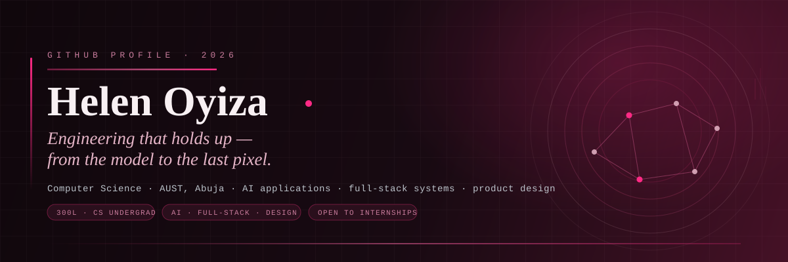

---

## 01. ABOUT

  <h3><b>Engineering that holds up — from the model to the last pixel.</b></h3>
  
<i>Computer Science undergraduate at AUST, exploring AI applications, full-stack systems, and product design.</i>

 

* **University:** 300-Level Computer Science Student at African University of Science and Technology (AUST)
* **Leadership:** Operations Coordinator for Cowrywise on campus & Student Member of PMI
* **Core Focus:** Full-Stack Web Development, Python & Machine Learning, Modular Software Design

---

## 02. RECOGNITION

  <h3><b>Proof, on the record.</b></h3>

| Competition / Event | Project / Focus | Result |
| :--- | :--- | :--- |
| **Udara "The Build" Challenge** | Full-Stack AI Learning Platform | **4th Place / National Semi-Finalist** 🏆 |
| **StacStart Hackathon** | AfriConnect Web Platform | **Finalist & Builder** 🚀 |
| **AIB Ship Hackathon** | RoutePin Urban Navigation | **Featured Project** 🗺️ |
| **PMI Student Chapter** | Project Management & Analytics | **Collaborator / Leadership** 💡 |

---

## 03. SELECTED WORK

  <h3><b>Products, not assignments.</b></h3>
  
<i>Systems built with real constraints—clean state management and robust architecture.</i>

| Project | Tech Stack | Description | Links |
| :--- | :--- | :--- | :--- |
| **RoutePin** | Next.js, TypeScript, Tailwind | Interactive travel planner and urban navigation platform featuring dynamic carousels and booking modals. | [GitHub Repo](https://github.com/Ellena01) |
| **Hunuko (Animatrix)** | Python, Modular Architecture | Collaborative multi-member AI learning system transforming raw notes and PDFs into interactive study materials. | [GitHub Repo](https://github.com/Ellena01) |
| **Personal Finance Manager** | Python, SQLite, Pytest | Command-line financial tracking utility featuring automated unit testing and file storage integration. | [GitHub Repo](https://github.com/Ellena01) |

---

## 04. THE TOOLS I REACH FOR

### 💻 Languages & Frameworks

  

### ⚙️ Backend, APIs & Infrastructure

  

---

## 05. COMMIT LOG

  <h3><b>A year of building, one square at a time.</b></h3>

  
  

 

  

---

## 06. CERTIFICATIONS & FOUNDATIONS

| Credential / Program | Category | Status |
| :--- | :--- | :--- |
| **Cisco Networking Academy** — Intro to Cybersecurity | Cybersecurity | **Completed (97%)** ✅ |
| **GitHub Education** — Student Developer Pack | Developer Tooling | **Verified Member** 🎒 |
| **NNPC Gas Infrastructure (NGIC)** — ICT Industrial Training | Systems & Operations | **Completed (Industrial Training)** ⚡ |

---

## 07. CONNECT

  <h3><b>Let's build something worth explaining.</b></h3>

| Platform | Link |
| :---: | :---: |
| **📧 Email** | `Oyizaellena@gmail.com` |
| **💼 LinkedIn** | [Connect on LinkedIn](https://linkedin.com) |
| **📂 GitHub** | [Explore My Repos](https://github.com/Ellena01) |

*“Engineering that holds up — from the model to the last pixel.”*

 />

