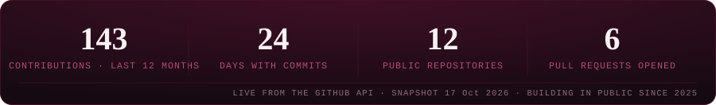
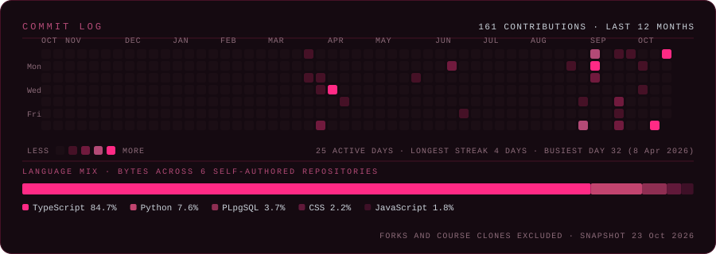

**[Explore My Work](#03-selected-work)** &nbsp;·&nbsp; **[Recognition](#02-recognition)** &nbsp;·&nbsp; **[GitHub Activity](https://github.com/Ellena01)** &nbsp;·&nbsp; **[Connect With Me](#06-connect)**

## 01. ABOUT

I'm **Helen Oyiza** — a 300-level Computer Science undergraduate at the **African University of Science and Technology (AUST), Abuja**, and an aspiring entrepreneur who would rather build the thing than describe it.

I work at the intersection of **AI applications**, **full-stack systems** and **product design**. The pattern in everything below is the same: take something genuinely complicated — a wall of lecture notes, a scattered job board, a shader that won't behave — and turn it into something a person can actually use.

I care about work that **holds up**: data models that make sense, interfaces that don't lie about what the system is doing, and code somebody else can read six months later.

<table>
<tr>
<td width="52%" valign="top">
<b>Where I'm strongest</b>  
<b>AI applications</b> — tutoring flows, structured model output, matching and scoring pipelines  
<b>Full-stack</b> — TypeScript front ends on Next.js, Python services behind them  
<b>Product design</b> — information hierarchy, state design, typography, human-computer interaction  
<b>Craft</b> — hand-written GLSL, motion, and interfaces that feel considered
</td>
<td width="48%" valign="top">
<b>Where I'm going next</b>  
<b>Machine learning foundations</b> — the part of the stack I want to reason about rather than call  
<b>Backend and systems</b> — FastAPI, Postgres, background jobs, the unglamorous half of the product  
<b>Security</b> — learning to threat-model what I build, not just ship it  
<b>Human-centered AI</b> — speech as a learning interface, offline-first education tools, and how an AI tutor should remember
</td>
</tr>
</table>

---

## 02. RECOGNITION

Two records I can point to with evidence. **Only claims with a public paper trail live on this page** — anything I can't source stays off it.

<table>
<tr>
<td width="50%" valign="top">
<b>🏆 Udara “The Build” Challenge 2026</b> 
<b>4th place · Team Animatrix</b>  
Built <b>Hunuko / CogniFlow</b> — an AI learning companion — from idea to live demo inside a hackathon window: animated concept scenes, quizzes, flashcards and an oral-exam mode.  
NSK AI Udara Project Build · 2026 · Project: Hunuko / CogniFlow 
Evidence: <a href="https://github.com/Animatrix-Hunuko/Hunuko">team repository</a> · <a href="https://hellena-portfolio-pi.vercel.app/">case study</a>
</td>
<td width="50%" valign="top">
<b>⚙️ CogniFlow scene engine — merged</b> 
<b>Selected contribution · PR #2</b>  
Designed and shipped the phase-1 CogniFlow scene pipeline: a Gemini analysis pass that decides what a concept needs, a router that calls SymPy-backed physics, geometry and algebra engines only when required, then a scene plan and a typed scene graph.  
Python · Pydantic v2 · Google GenAI SDK · SymPy · 2026 
Evidence: <a href="https://github.com/Animatrix-Hunuko/Hunuko/pull/2">merged pull request</a>
</td>
</tr>
</table>

---

## 03. SELECTED WORK

Four builds, four different lessons. Every demo below is live, and every repository link points at code I wrote — including, in Hunuko's case, the specific part that is mine.

<table>
<tr>
<td width="50%" valign="top">
<b>Hunuko / CogniFlow</b>  
An AI study companion that turns notes and PDFs into conversations, quizzes, flashcards and animated scenes — instead of another wall of text.  
<b>Why it matters:</b> students already have the material. What they don't have is anything that examines them on it. 
<b>My part:</b> the phase-1 scene engine and the brand mark, inside Team Animatrix's codebase.  
<code>Python</code> <code>FastAPI</code> <code>Pydantic</code> <code>SymPy</code> <code>Gemini API</code> <code>React</code> <code>TypeScript</code> <code>Firebase</code>  
<b>Live prototype · team project</b> · <a href="https://github.com/Animatrix-Hunuko/Hunuko">Repository</a> · <a href="https://cogni-flow-5ihe.vercel.app/">Live demo</a>
</td>
<td width="50%" valign="top">
<b>Pathify</b>  
Opportunity intelligence, built African-first: a Python crawler sweeps verified sources, a skills taxonomy normalises what each role actually asks for, and a Next.js dashboard scores every opportunity against your skills and tracks the application.  
<b>Why it matters:</b> the opportunities exist. Students find them months late, or not at all — and rarely know which gap to close first.  
<code>Next.js 16</code> <code>TypeScript</code> <code>Tailwind CSS</code> <code>Supabase</code> <code>Python</code> <code>Gemini</code> <code>Zod</code> <code>Node test runner</code>  
<b>Live</b> · <a href="https://github.com/Ellena01/pathify">Repository</a> · <a href="https://pathify-iq.vercel.app/">Live demo</a>
</td>
</tr>
<tr>
<td width="50%" valign="top">
<b>RoutePin</b>  
An editorial travel site for tailor-made Canadian road trips: a click-to-centre destination carousel, an eight-stop route timeline, and a trip customiser that takes destination, party size and dates.  
<b>Why it matters:</b> multi-stop trips usually get planned across screenshots, tabs and spreadsheets.  
<code>Next.js 16</code> <code>TypeScript</code> <code>Tailwind CSS v4</code>  
<b>Live</b> · <a href="https://github.com/Ellena01/routepin">Repository</a> · <a href="https://routepin-chi.vercel.app/">Live demo</a>
</td>
<td width="50%" valign="top">
<b>Cinematic Artifact</b>  
A real-time WebGL surface: icosahedral geometry displaced <i>every frame</i> by layered simplex noise in hand-written GLSL, lit by a per-pixel Fresnel rim, with scroll interpolation, camera orbit and render calls sharing one clock.  
<b>Why it matters:</b> an experiment in whether a page's motion and its imagery can come from a single source of truth, instead of being composited after the fact.  
<code>Next.js</code> <code>Three.js</code> <code>GLSL</code> <code>GSAP</code> <code>Web Audio</code>  
<b>Live</b> · <a href="https://github.com/Ellena01/cinematic-artifact">Repository</a> · <a href="https://cinematic-artifact.vercel.app/">Live demo</a>
</td>
</tr>
</table>

<b>Also in the wild:</b> <a href="https://github.com/Ellena01/nigeria-celebrates">Nigeria Celebrates</a> — an interactive culture platform across all 36 states with a live quiz arena and pulse feed (<a href="https://frontend-five-phi-30.vercel.app/">demo</a>, running on seeded demo data) · <a href="https://github.com/Ellena01/Hellena-portfolio">Hellena-portfolio</a> — the long-form version of this profile, with full case studies (<a href="https://hellena-portfolio-pi.vercel.app/">live</a>).

---

## 04. CAPABILITIES

Listed the way my own portfolio lists them — by what I actually ship with, and what I'm still working through. No percentages: nobody can measure those honestly.

<table>
<tr><th width="24%" align="left">Area</th><th width="38%" align="left">Shipping with</th><th width="38%" align="left">Going deeper on</th></tr>
<tr>
<td><b>Languages</b></td>
<td>TypeScript · Python · JavaScript · SQL</td>
<td>Python (deeper) · type systems</td>
</tr>
<tr>
<td><b>Frontend &amp; product</b></td>
<td>React · Next.js · Tailwind CSS · Framer Motion</td>
<td>Design systems · accessibility · motion</td>
</tr>
<tr>
<td><b>Backend, data &amp; APIs</b></td>
<td>Supabase · Firebase · REST · Pydantic</td>
<td>FastAPI · Postgres · background jobs</td>
</tr>
<tr>
<td><b>AI &amp; retrieval</b></td>
<td>Gemini API · prompt design · structured output</td>
<td>RAG evaluation · speech interfaces</td>
</tr>
<tr>
<td><b>Graphics &amp; interaction</b></td>
<td>Three.js · GLSL · GSAP</td>
<td>Shader mathematics</td>
</tr>
<tr>
<td><b>Tooling &amp; delivery</b></td>
<td>Git · GitHub · VS Code · Vercel</td>
<td>CI workflows · containers</td>
</tr>
</table>

Everything in the middle column appears in the source of a project linked above. The right-hand column is current study, not a claim.

---

## 05. ACTIVITY

Real numbers, pulled straight from the GitHub API — no third-party badge service in the middle. This panel is regenerated by a scheduled workflow in this repository (`scripts/build_activity_panel.py`), so it can't drift from the source, and it can't break because somebody else's server did.

<b>Read it honestly:</b> a contribution count is a record of commits pushed to public repositories. It measures how much I shipped in the open, not how much I learned — and most of the work above happened in bursts around hackathons, coursework and build weeks. The panel is a dated snapshot, not a live feed.

 

[Contribution graph on my profile](https://github.com/Ellena01) · [All repositories](https://github.com/Ellena01?tab=repositories)

---

## 06. CONNECT

I'm early, deliberate about it, and looking for the right rooms: **internships**, **AI and education technology work**, **campus and student-community programmes**, and collaborators who take the beginning of something seriously.

If you're building something where the craft matters — or you just want to talk about learning, AI and what students actually need — my inbox is open.

**GitHub** &nbsp;·&nbsp; [Ellena01](https://github.com/Ellena01) 
**LinkedIn** &nbsp;·&nbsp; [linkedin.com/in/helenoyiza](https://www.linkedin.com/in/helenoyiza) 
**Portfolio** &nbsp;·&nbsp; [hellena-portfolio-pi.vercel.app](https://hellena-portfolio-pi.vercel.app/) 
**Email** &nbsp;·&nbsp; [Oyizaellena@gmail.com](mailto:Oyizaellena@gmail.com)

Profile README last updated 17 October 2026 · Hand-built: SVG artwork, a Python generator for the activity panel, and no JavaScript — GitHub strips it anyway.

